# TRACE

> 흩어진 차 정보를 밤하늘의 비행기와 비행운으로 보여 주고, 카드 4장(전비·정비·코인·지역)으로 요약하는 플레오스 커넥트(AAOS)용 차량 앱


<p align="center">
  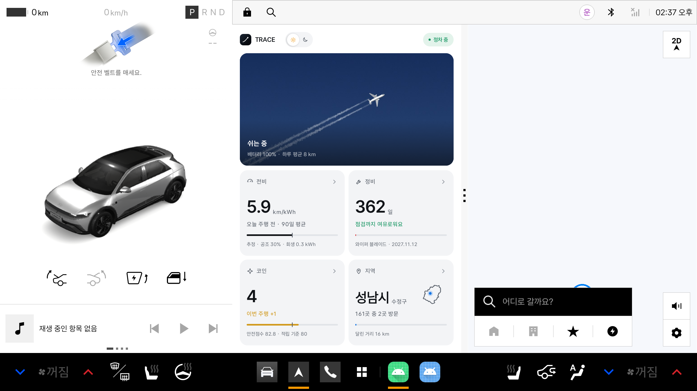
</p>
<p align="center"><sub>플레오스 커넥트 에뮬레이터 3분할 화면. 가운데 칸이 TRACE(홈 · 정차 중)</sub></p>

---

## 1. 기획 배경

### Why TRACE?

차는 매일 수많은 순간을 기억합니다.  
어떻게 달렸는지, 언제 충전했고, 무엇을 점검했는지.

하지만 그 기록을 찾아보고 남기는 일은 여전히 운전자의 몫입니다.

TRACE는 여기서 시작했습니다.  
차가 이미 알고 있는 순간이라면, 운전자는 굳이 기록하지 않아도 되지 않을까?

운전 중에는 필요한 말 한마디만, 멈춘 뒤에는 차와 함께한 하루를 기록합니다.

**TRACE는 차와 함께한 시간의 흔적을 남깁니다.**

---

## 2. 주요 기능

화면 이동은 `ui/TraceNavigation.kt`의 Navigation Compose 경로를 기준으로 정리했습니다.

| 화면 | 기능 | 근거 코드 |
| --- | --- | --- |
| **홈 · 정차 (S01)** | 하늘 사진 위에 기체 상태 문구("쉬는 중"), 배터리·하루 평균 거리 표시. 전비·정비·코인·지역 타일 4장을 누르면 상세 화면으로 이동 | `ui/screens/home/HomeScreen.kt`, `HomeViewModel.kt` |
| **홈 · 주행 (S02)** | 기어(D·R)와 차속(> 0)이 2초 이어지면 주행 상태로 판정. 앱 바 칩이 "주행 중"으로 바뀌고 타일은 요약값만 보여 주며 상세 화면으로 가지 않음 | `domain/DriveStateDetector.kt`, `HomeScreen.kt` (`TileGrid`) |
| **주행 시작 시 자동 복귀 (A-02)** | 상세 화면에 있다가 주행이 시작되거나 시스템 UX 제한(`isRequiresDistractionOptimization`)이 켜지면 홈으로 돌아감 | `ui/TraceNavigation.kt`, `data/uxrestrictions/CarUxRestrictionsMonitor.kt` |
| **기체 상태 (B-03 · B-04)** | 차속으로 "천천히/매끄럽게" 비행, 2분 안에 급가속·급감속이 2회 이상이면 "거칠었음" | `domain/FlightStatusResolver.kt`, `domain/DrivingEventDetector.kt` |
| **우주 비행** | 홈 하늘을 누르면 반복·음소거 영상 재생(테마와 분할 모드에 따라 영상 4종 중 선택) | `ui/screens/spaceflight/SpaceFlightScreen.kt` |
| **전비 상세 (S03)** | 최근 90일 평균 전비(**추정**), 회생제동·공조 비중·급가속·충전 횟수, 충전 타이밍 예측, 주행 기록 달력, 월별 전비, 이번 달 예측 | `domain/EfficiencyCalculator.kt`, `domain/ChargeForecaster.kt`, `domain/ChargeDetector.kt` |
| **코인 상세 (S06)** | 안전점수(시작 85점, `기존 × 0.98 + 이번 1km × 0.02`), 1km 구간별 급가속·급감속·급정거·과속 기록, 80점 이상에서 깨끗한 1km마다 1코인 적립 | `domain/SafetyScorer.kt`, `domain/KmSegmenter.kt`, `domain/CoinLedger.kt`, `domain/DrivingThresholds.kt` |
| **정비 상세 · 기록 추가 (S04 · S05)** | 점검 항목 8개의 남은 기간·거리, 정비 달력, 정비 기록 목록과 필터, 기록 추가 양식(날짜·주행거리·장소·항목·비용·메모) | `domain/MaintenanceSchedule.kt`, `domain/MaintenanceCalculator.kt`, `ui/screens/maintenance/` |
| **지역 상세 (S08)** | 161개 지역 방문 지도(확대·축소·드래그), 지역별 달린 거리·머문 시간, 위치 기록 켜기·끄기, 지역별·전체 기록 지우기 | `domain/region/RegionLocator.kt`, `domain/region/RegionVisitTracker.kt`, `ui/screens/region/` |
| **테마 (A-03)** | 해·달 스위치로 라이트·다크 전환. 시스템 테마가 바뀌면 선택을 지우고 시스템을 따름 | `data/settings/ThemeSetting.kt`, `domain/ThemeResolver.kt` |

> 상점·꾸미기(S07)는 현재 빈 화면(`PlaceholderScreen`)이고, 내 우주(`universe`)는 경로 상수만 있으며 화면은 없습니다.

---

## 3. 스크린샷

### 화면별 비교

3분할은 라이트 테마, 2분할은 다크 테마로 캡처했습니다. 모든 화면은 플레오스 커넥트 에뮬레이터(2560 × 1440)에서 직접 캡처했으며, 표시된 값은 에뮬레이터에 쌓인 실제 기록입니다.

| 화면 | 3분할 | 2분할 |
| --- | --- | --- |
| 홈 · 정차 |  | 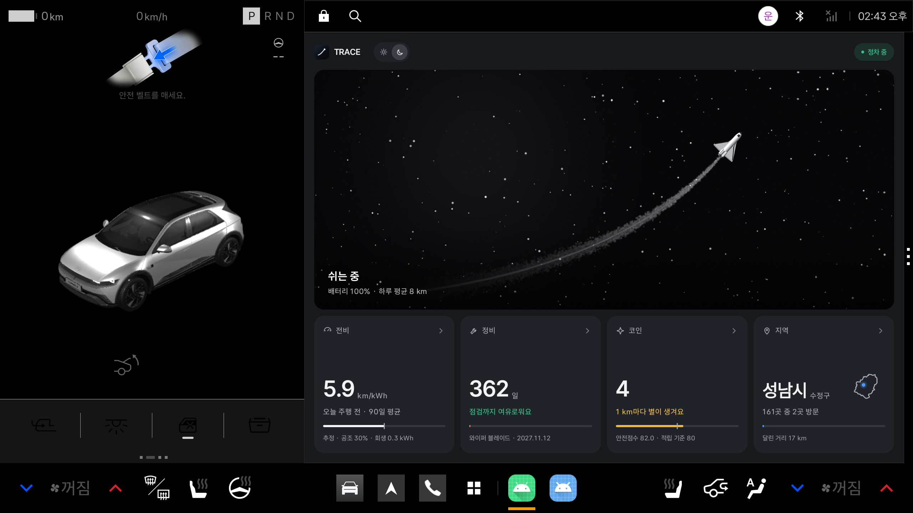 |
| 홈 · 주행 | 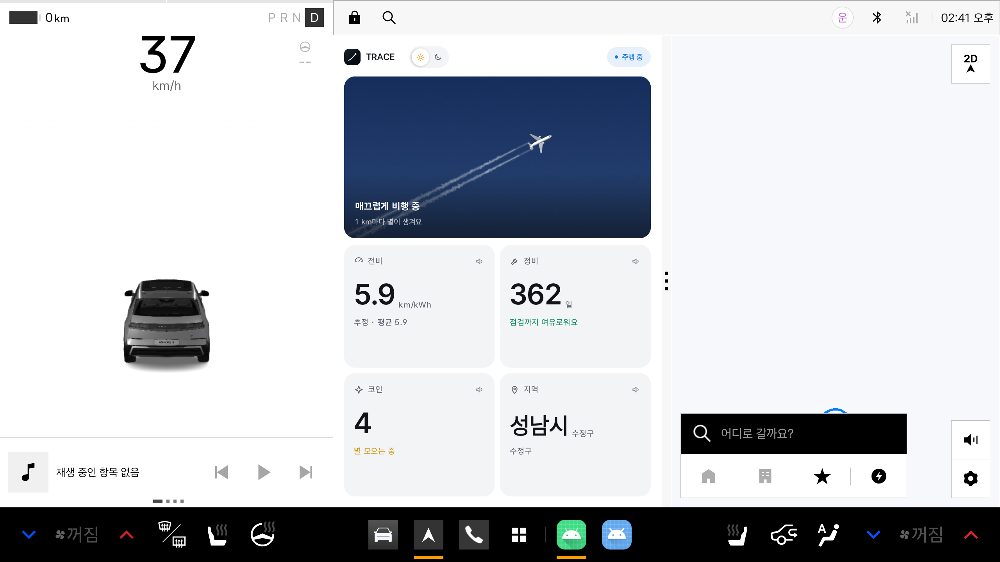 | 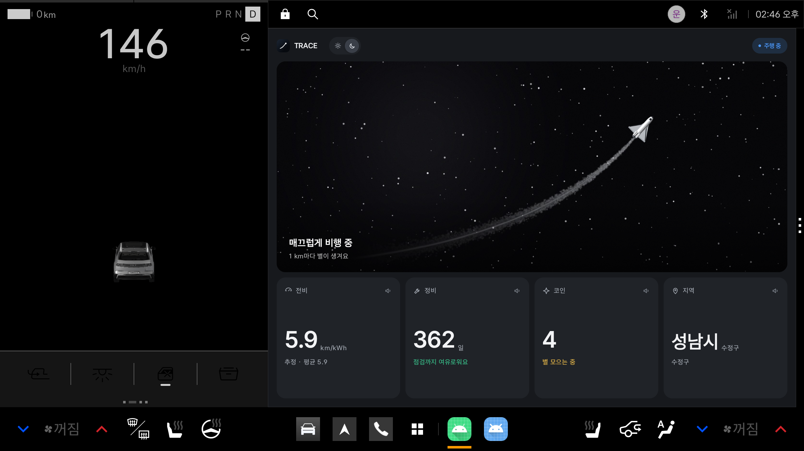 |
| 우주 비행 | 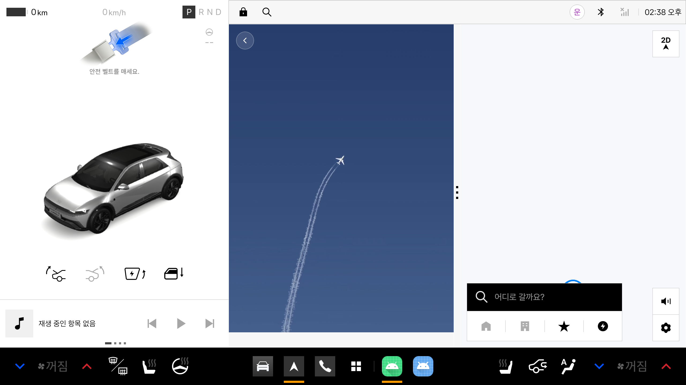 | 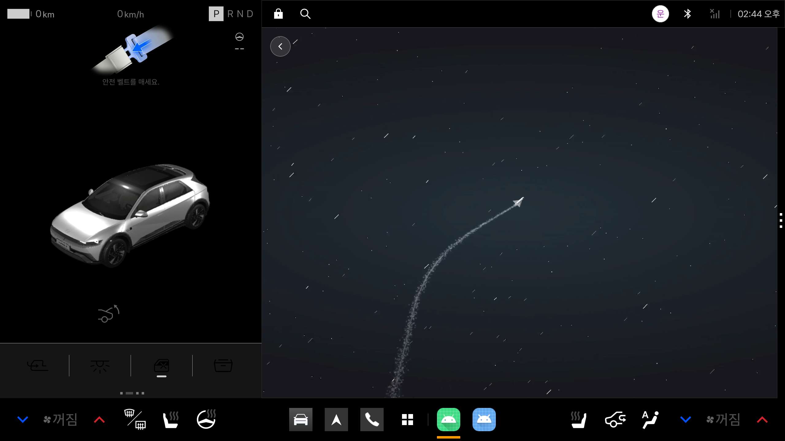 |
| 전비 | 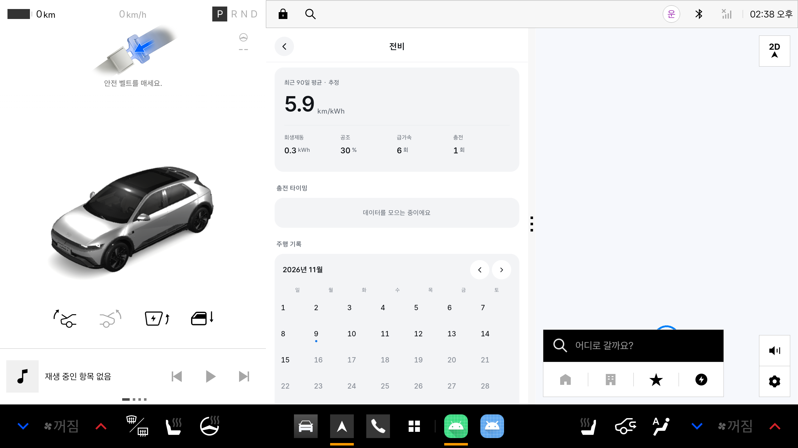 | 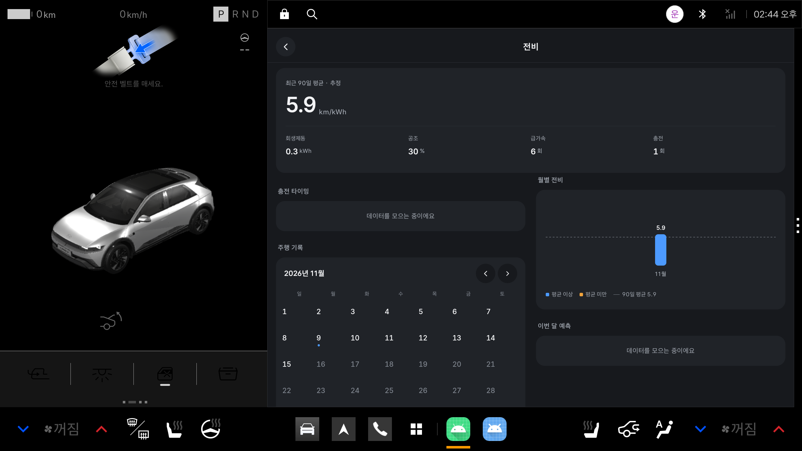 |
| 코인 | 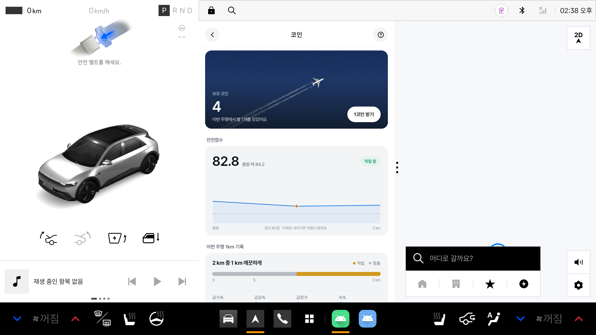 | 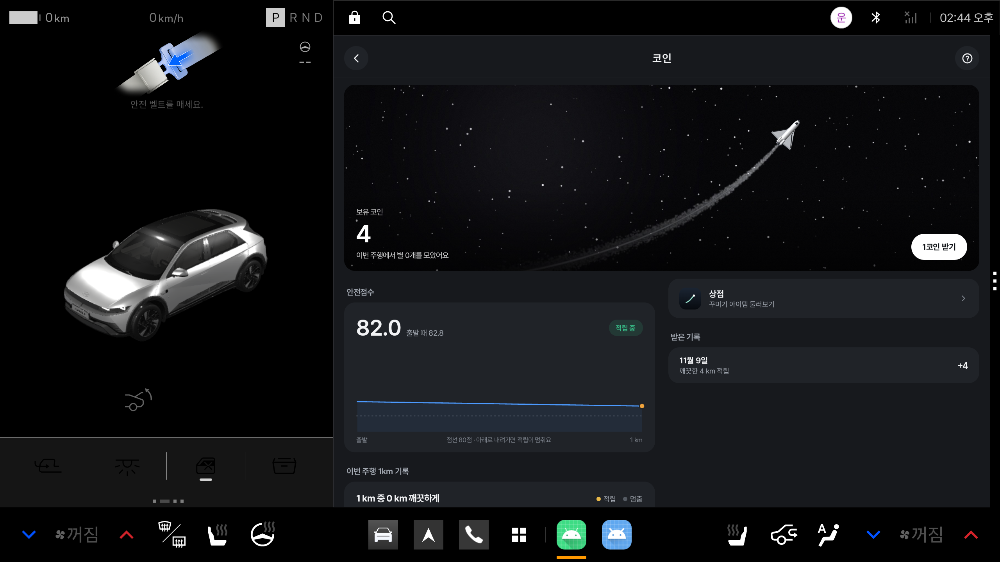 |
| 정비 | 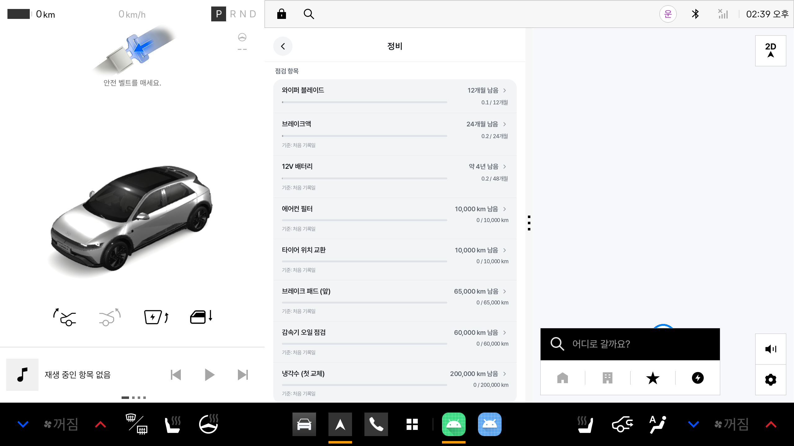 | 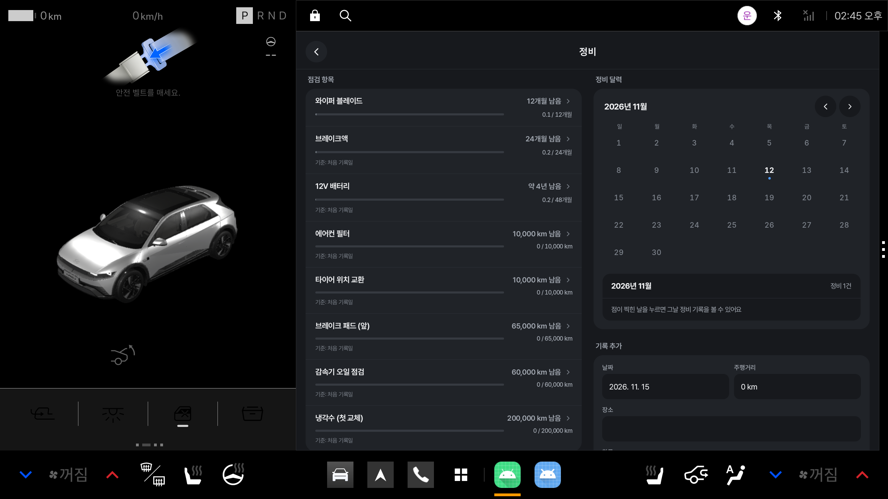 |
| 정비 · 기록 추가 | 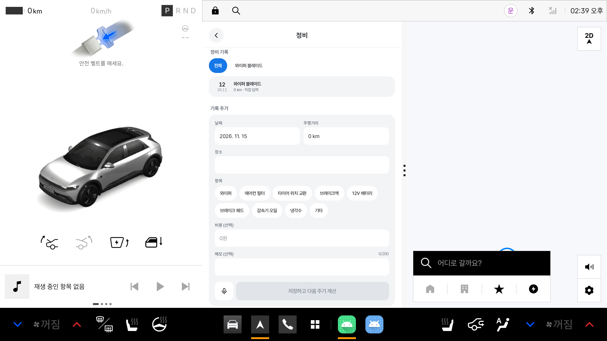 | 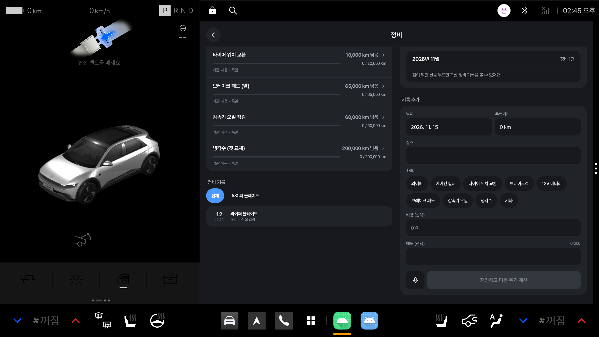 |
| 지역 | 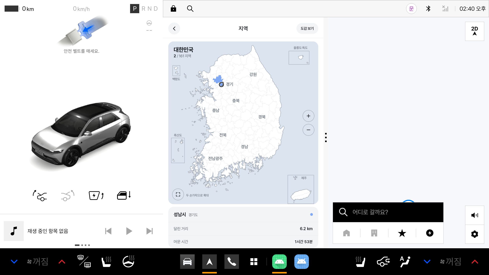 | 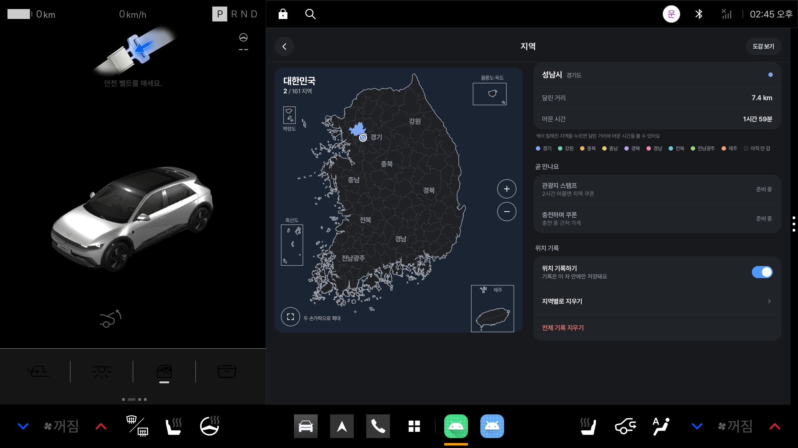 |
| 지역 · 위치 기록 | 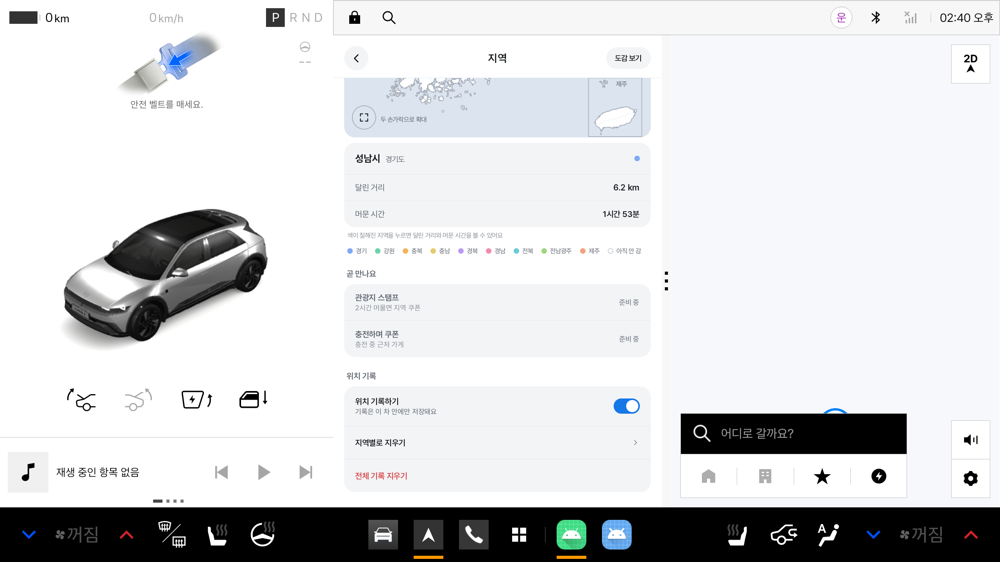 | 2분할은 한 화면에 모두 보임 (위 `지역`) |
### 분할 모드에 따른 레이아웃

`TraceTheme`가 TRACE 칸의 가로/세로 비율을 재서 `TraceLayout.select()`로 배치를 고릅니다. 비율이 1.125(두 기준 0.75와 1.5의 가운데) 이상이면 **Wide(1200 × 800 기준)**, 아니면 **Compact(600 × 800 기준)**이고, `scale = min(칸 가로 / 기준 가로, 칸 세로 / 기준 세로)`로 `LocalDensity`를 덮어써 디자인 px를 그대로 dp로 씁니다(`ui/theme/Theme.kt`, `TraceLayout.kt`).

- **홈**: 3분할은 하늘 무대 : 타일 = 250 : 390에 타일 **2 × 2**, 2분할은 440 : 252에 타일 **한 줄 4개**이며 하늘 사진도 와이드 버전(`sky_*_hero_wide.jpg`)으로 바뀝니다(`HomeLayoutSpec`).
- **상세 화면**: 2분할에서는 전비·정비·코인·지역이 `TwoColumns`로 **2열** 배치됩니다. 3분할에서는 한 줄로 쌓여 세로 스크롤로 길어집니다.
- Manifest의 `configChanges="screenSize|smallestScreenSize|screenLayout|orientation"`로 분할 모드가 바뀌어도 Activity를 다시 만들지 않고 상태·영상을 유지합니다.

---

## 4. 기술 스택

| 구분 | 내용 |
| --- | --- |
| Language | Kotlin 2.2.10 (JVM target 11) |
| Build | Android Gradle Plugin 9.5.0, Gradle 9.6.0, KSP 2.3.10 |
| SDK | compileSdk 37 · minSdk 28 · targetSdk 34 |
| Android Automotive OS | `android.hardware.type.automotive` 필수(`required=true`), `useLibrary("android.car")`, Activity에 `distractionOptimized=true` 메타데이터. **Car App Library는 사용하지 않음**(일반 Compose 앱, 런처 카테고리 `LAUNCHER`) |
| UI | Jetpack Compose (BOM 2026.02.01) + Material3 (기본 테마 색 대신 자체 `TraceColors` 토큰), XML 레이아웃 없음 |
| Navigation | Navigation Compose 2.7.7, 단일 Activity |
| Architecture | `ui` / `domain` / `data` 3계층, ViewModel + StateFlow(화면은 `UiState`만 받아 그림), 차량 신호는 `VehicleSignals` 인터페이스 하나로 받음 |
| DI | 별도 DI 라이브러리 없음. `TraceApplication`에서 객체를 만들어 생성자로 주입(수동 DI) |
| 비동기 | Kotlin Coroutines · Flow 1.9.0 (AndroidX 의존성을 통해 포함) |
| 로컬 DB | Room 2.8.4 (DB 버전 5, 테이블 9개) + SharedPreferences(테마·위치 기록 설정) |
| 영상 | Media3 ExoPlayer · UI 1.5.0 |
| 이미지 | 별도 이미지 로딩 라이브러리 없음(`res/drawable-nodpi` 리소스) |
| 네트워크 | 없음 (네트워크 라이브러리·전송 코드 없음) |
| 차량 연동 | Pleos Vehicle 2.3.2, NaviHelper 3.0.5, FusedLocation 1.1.3, AAOS `CarPropertyManager` · `CarUxRestrictionsManager` |
| 기타 AndroidX | core-ktx 1.10.1, lifecycle-runtime-ktx 2.6.1, activity-compose 1.8.0 |
| 테스트 | JUnit 4.13.2(단위 테스트 37개 파일), Compose UI Test, Espresso 3.5.1 |
| 글꼴 | Pretendard(본문), Inter(타일 큰 숫자) — 각 400·500·600·700 |

---

## 5. Infrastructure

| 항목 | 내용 |
| --- | --- |
| 백엔드 / 서버 | **없음.** 모든 계산은 기기 안에서 수행 |
| DB | Room(`trace.db`) — 주행 요약, 진행 중 주행, 충전, 1km 기록, 코인 지갑·기록, 정비 기록·기준점, 지역 방문. 원시 신호는 계산 후 버리고 요약만 저장 |
| 인증 | 없음 (`google-services.json`·Firebase 없음) |
| 스토리지 | 앱 내부 저장소만 사용. 위치 기록은 기기 밖으로 보내지 않음 |
| 정적 데이터 | `assets/regions_lookup.json`(시·군·구 판정용), `assets/regions_display.json`(지도 그리기용) — `tools/geo/build_regions.py`로 생성 |

### 차량 데이터 연동

| 신호 | 출처 | API |
| --- | --- | --- |
| 차속 (m/s, 100ms) | AAOS VHAL | `CarPropertyManager` · `VehiclePropertyIds.PERF_VEHICLE_SPEED` |
| 기어 (P/R/N/D) | AAOS VHAL | `CarPropertyManager` · `VehiclePropertyIds.GEAR_SELECTION` |
| 주행 중 UX 제한 | AAOS | `CarUxRestrictionsManager.isRequiresDistractionOptimization` |
| 브레이크 on/off · 조향각 · 방향지시등 | Pleos Vehicle SDK | `getBrake()` · `getSteeringWheel()` · `getTurnSignal()` |
| EV 배터리 % · 잔량(Wh) · 용량 · 충전구 | Pleos Vehicle SDK | `getEvBattery()` |
| 총 주행거리 · 주행 가능 거리 | Pleos Vehicle SDK | `getOdometer()` |
| 공조 전원 | Pleos Vehicle SDK | HVAC `HvacPowerStateListener` (읽기만) |
| 현재 위치 · 제한속도 | Pleos NaviHelper | `getCurrentLocationInfo()` · `onCurrentRoadSpeedLimit` |
| 보조 위치 | Pleos FusedLocation | `getLastKnownLocation()` (NaviHelper 위치가 1분 넘게 그대로일 때만) |

권한: `android.car.permission.CAR_SPEED`, `CAR_POWERTRAIN`, `pleos.car.permission.CAR_DRIVE` · `CAR_LIGHTS` · `CAR_ENERGY` · `CAR_INFO` · `CAR_CLIMATE` · `NAVI_ROUTE` · `FUSED_LOCATION` 등. 런타임 권한(dangerous)은 기기에서 조회해 요청합니다(`data/permission/RuntimePermissions.kt`). 차량 속성은 **읽기만** 합니다.

### 데이터 흐름

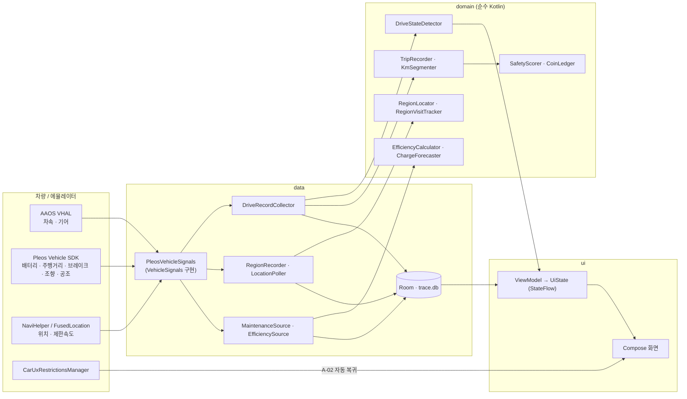

---

## 6. 프로젝트 구조

```
app/src/main/java/com/tracers/trace/
├── MainActivity.kt            # 단일 Activity, 런타임 권한 요청, TraceTheme + NavHost
├── TraceApplication.kt        # 앱 범위 단일 객체 생성(수동 DI), 권한 허용 후 수집 시작
├── data/                      # SDK 연결과 저장
│   ├── vehicle/               # VehicleSignals 인터페이스, PleosVehicleSignals(SDK + AAOS 구현)
│   ├── record/                # Room DB·DAO·Entity, 주행·충전·코인·정비 저장소, DriveRecordCollector
│   ├── region/                # 위치 주기 요청, 지역 방문 기록, 위치 기록 설정
│   ├── uxrestrictions/        # CarUxRestrictionsManager 감시 (A-02)
│   ├── permission/            # 런타임 권한 조회
│   ├── settings/              # 테마 선택 저장
│   └── sample/                # @Preview·테스트용 샘플 상태
├── domain/                    # 순수 Kotlin 계산 (단위 테스트 대상)
│   ├── DriveStateDetector     # 기어 + 차속 → 정차/정지/주행
│   ├── TripRecorder, KmSegmenter, SpeedSpikeFilter, DrivingEventDetector
│   ├── SafetyScorer, CoinLedger, DrivingThresholds
│   ├── EfficiencyCalculator, ChargeDetector, ChargeForecaster
│   ├── MaintenanceSchedule, MaintenanceCalculator
│   ├── FlightStatusResolver, ThemeResolver
│   └── region/                # 좌표 → 시·군·구 판정, 방문 거리·시간 누적
└── ui/
    ├── TraceNavigation.kt     # 경로, NavHost, A-02 자동 복귀
    ├── theme/                 # TraceColors·TraceType·TraceDimens·TraceLayout·TraceTheme(scale)
    ├── components/            # Tile, DetailHeader, ProgressBar, StatusChip, TwoColumns 등
    ├── icons/                 # TraceIcons(ImageVector)
    └── screens/               # home, spaceflight, efficiency, coin, maintenance, region

app/src/main/assets/           # 지역 경계 JSON
app/src/main/res/              # drawable-nodpi(하늘 사진), raw(비행 영상), font(Pretendard·Inter)
design/                        # 디자인 원본 HTML·자산·스크린샷
docs/                          # 기획안, PLEOS API 확인 현황, 지역 경계 데이터 출처, README 이미지
tools/geo/                     # 지역 경계 JSON 생성·검사 스크립트 (Python)
tools/scenario/                # 버추얼 콘솔 시나리오 재생기 (PC에서 실행, 앱 코드와 별개)
```

---

## 7. 실행 방법

### 요구 환경

- Android Studio (AGP 9.5.0을 지원하는 버전), Gradle Wrapper 9.6.0
- JDK 25 (Gradle 데몬 요구 버전, `gradle/gradle-daemon-jvm.properties`. Android Studio 내장 JetBrains Runtime 25로 확인) — 소스·타깃 호환성은 Java 11
- 플레오스 커넥트 Automotive 에뮬레이터 (Android 14, `targetSdk 34`)
- Pleos SDK는 `settings.gradle.kts`에 등록된 Maven 저장소(`nexus-playground.pleos.ai`)에서 받습니다.

### 개발·테스트 에뮬레이터

개발과 스크린샷 캡처에 사용한 에뮬레이터입니다(값은 `adb shell getprop`, `adb shell wm size`·`wm density`로 확인).

| 항목 | 값 |
| --- | --- |
| 에뮬레이터 | **Pleos Connect v2.1.0** (AVD `Pleos_Connect_v2.1.0`, 빌드 `release_connect_v2.1.0`) |
| OS | Android 14 (API 34), arm64 |
| 디스플레이 | 2560 × 1440 px, 160 dpi |

### 화면 규격

TRACE는 분할 모드에 따라 칸 크기가 달라지며, 디자인 기준 크기에 맞춰 `scale`을 계산해 그립니다(`ui/theme/TraceLayout.kt`, `Theme.kt`).

| 분할 모드 | TRACE 칸 실측 (px) | 디자인 기준 (CSS px) | 배치 |
| --- | --- | --- | --- |
| 3분할 | 841 × 1210 | 600 × 800 | Compact — 홈 타일 2 × 2, 상세 화면 1열 |
| 2분할 | 1682 × 1210 | 1200 × 800 | Wide — 홈 타일 한 줄 4개, 상세 화면 2열 |

### 키 설정

프로젝트 루트의 `local.properties`(Git 제외)에 아래 **키 이름**을 추가합니다. 값은 공유하지 않습니다.

```properties
sdk.dir=<Android SDK 경로>
PLEOS_CLIENT_ID=<발급받은 값>
PLEOS_CLIENT_SECRET=<발급받은 값>
```

> 두 값은 `BuildConfig`로 들어가지만 현재 앱 코드에서 읽는 곳은 없습니다. 없으면 빈 문자열로 빌드됩니다.

### APK로 바로 설치

빌드 없이 설치할 수 있는 release APK를 저장소에 포함했습니다.

| 항목 | 내용 |
| --- | --- |
| 파일 | [`apk/TRACERS_TRACE_release.apk`](apk/TRACERS_TRACE_release.apk) (약 64MB) |
| 빌드 | `./gradlew assembleRelease` (release 키 서명, versionName 1.0) |
| SHA-256 | `9be5f9a39a3981977b3b64d8f6a8bdb44cc81ab57802880a0ef0e5e5b4345c13` |

```bash
adb install apk/TRACERS_TRACE_release.apk
adb shell am start -n com.tracers.trace/.MainActivity
```

> - 처음 실행하면 위치 관련 권한 2개를 묻습니다. 모두 허용해야 차량 신호 수집이 시작됩니다.
> - 같은 패키지의 debug 빌드가 설치돼 있으면 서명이 달라 설치되지 않습니다. `adb uninstall com.tracers.trace` 후 설치하세요.
> - release를 직접 빌드하려면 `local.properties`에 `TRACE_RELEASE_STORE_FILE`, `TRACE_RELEASE_STORE_PASSWORD`, `TRACE_RELEASE_KEY_ALIAS`, `TRACE_RELEASE_KEY_PASSWORD`를 넣습니다. 없으면 서명 없는 APK가 만들어집니다.

### 빌드 · 설치

```bash
./gradlew assembleDebug          # 빌드
./gradlew testDebugUnitTest      # 단위 테스트
./gradlew installDebug           # 연결된 에뮬레이터에 설치
adb shell am start -n com.tracers.trace/.MainActivity
```

첫 실행 때 런타임 권한(차속, FusedLocation)을 허용해야 차량 신호 수집이 시작됩니다. 허용하지 않으면 홈에 안내 문구가 표시됩니다.

### 에뮬레이터에서 차량 신호 바꾸기

- 버추얼 콘솔에서 기어·속도·배터리 등을 직접 바꿀 수 있습니다.
- 시나리오를 시간 순서대로 재생하려면 PC에서 아래를 실행합니다. 스크립트는 버추얼 콘솔 API(`127.0.0.1:8088`)에 차량 신호만 보내고 앱은 건드리지 않습니다.

```bash
adb forward tcp:8088 tcp:8088
python3 tools/scenario/replay.py tools/scenario/sample_30s.json
```

---

## 8. 팀원 및 역할

| 이름 | 역할 | 담당 |
| --- | --- | --- |
| 강예서 | 팀장 | 서비스 기획 및 개발 총괄 |
| 방승주 | 팀원 | 서비스 기획·앱 디자인·시연 콘텐츠 제작 |

---

## 데이터·글꼴 출처

| 자료 | 출처 | 라이선스 |
| --- | --- | --- |
| 지역 경계 | 국가데이터처 통계지리정보서비스(SGIS) 행정동 경계, [vuski/admdongkor](https://github.com/vuski/admdongkor) ver20261001 가공본을 TRACE가 시·군·구 단위로 합치고 단순화함 | 공공누리 제1유형 · CC BY 4.0 |
| Pretendard (본문 글꼴) | [orioncactus/pretendard](https://github.com/orioncactus/pretendard) | SIL OFL 1.1 |
| Inter (숫자 글꼴) | [rsms/inter](https://github.com/rsms/inter) | SIL OFL 1.1 |
